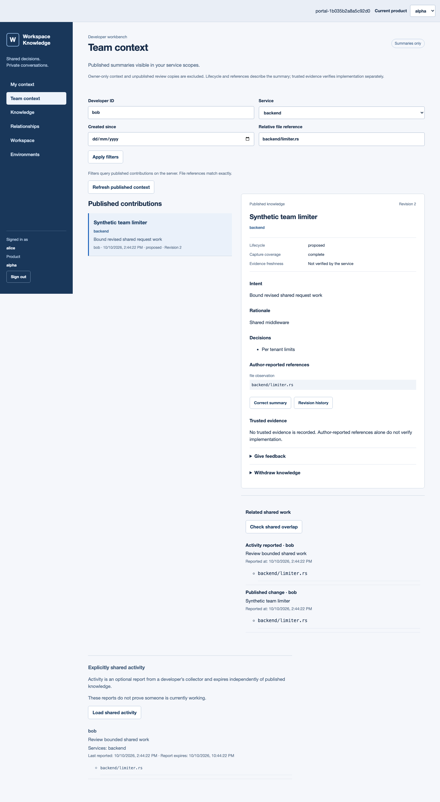

# Workspace Knowledge

**Development context your team can reuse.**

Workspace Knowledge is an open-source, on-premises system for sharing the decisions, constraints and rationale behind development work. Developers keep their own context, review summaries, and make useful knowledge available to teammates and coding agents within approved product and service boundaries.

Git shares the code. Workspace Knowledge helps explain why it changed, what was tried, and what another developer should know before building on it.

**Pre-release:** the hosted portal and local workflows have bounded acceptance evidence. Capture coverage depends on the client, version and surface. Production identity, native packaging and security gates remain open; see [current status](docs/architecture/completion-matrix.md).

[Quickstart](#quickstart) · [Team setup](#team-setup) · [Client coverage](#client-coverage) · [Documentation](#documentation) · [Contributing](CONTRIBUTING.md)

## What you get

- **My context:** owner-only summaries and structured notes, with editing, deletion and explicit submission for review.
- **Team context:** published summaries filtered by developer, service, date and file. Teammates see summaries, not conversation messages.
- **Coding-agent retrieval:** scoped search, context, overlap notices and other knowledge tools through MCP.
- **Device controls:** connection reports, requested permissions, pause and revocation, with pending and stale states shown explicitly.
- **Review and provenance:** revision history, withdrawal, reviewed relationships and separately verified evidence. A proposed decision does not become an implemented fact.
- **On-premises operations:** PostgreSQL storage, scoped administration, retention controls and encrypted backup/restore tooling. Environment secrets use a separately authorized OpenBao broker.



*Team context, shown with synthetic data from the local acceptance test.*

## Quickstart

Try the scope and consent workflow before installing a collector or hosting a server.

You need **Rust** (the repository pins its version), a **C build toolchain**, and **Python 3**. Rustup uses `rust-toolchain.toml` to select the required toolchain. On macOS, install Xcode Command Line Tools; on Windows, install MSVC build tools; on Linux, install your distribution's C build tools.

```sh
git clone --branch codex/cursor-native-capture https://github.com/DharanesshMD/workspace-knowledge.git
cd workspace-knowledge
./scripts/cargo build --locked -p wk-cli
python3 scripts/demo.py
```

On Windows, use `cargo build --locked -p wk-cli` and `python scripts/demo.py` instead of the last two commands. These instructions target the current pre-release branch, `codex/cursor-native-capture`.

The demo creates a temporary synthetic workspace, approves one service, rejects out-of-scope paths, replays a visible conversation fixture and checks that pause stops eligibility. It ends with `Synthetic consent, scope, replay, and pause checks passed.` and removes its temporary state. It does not publish anything or read real chats. **No database, Node.js, model, account or credential store is needed for this demo.**

## Team setup

Choose the path that matches your role:

| I want to… | Start here |
|---|---|
| Join an existing team server | [Install the user tools and connect a device](docs/operations/install.md#join-a-team-server) |
| Host the portal for my team | [Server setup](docs/operations/install.md#host-a-team-server), then [hosted operations](docs/operations/hosted-portal.md) |
| Configure a supported coding client | [Collector and adapter setup](docs/adapters/setup.md) |
| Develop or test this project | [Contributing](CONTRIBUTING.md) |

On macOS/Linux, one command builds and installs all five user tools:

```sh
./deploy/scripts/install-source.sh
```

The installer uses the pinned Rust toolchain, installs into `~/.local/bin` by default, and does not enable capture, modify client profiles or register startup services. Add that directory to your PATH if needed. Linux collector builds also need `pkg-config` and `libdbus-1-dev`; persistent capture requires a working native credential store. Node.js 22 is needed only when building the web console. See [platform prerequisites and Windows installation](docs/operations/install.md#install-the-tools).

The hosted portal uses the team's configured OIDC sign-in. Each developer approves local folders and connects their own collector; a browser setting cannot grant access to an unapproved local workspace. The developer and server operator setup steps are separate because their permissions and credentials are different.

## How it works

1. **Approve a workspace.** Bind capture to explicit product/service folders; personal, sibling and unknown contexts stay outside that approval.
2. **Capture supported visible content locally.** Enabled adapters feed an encrypted private journal. Unsupported or ambiguous sessions are held.
3. **Generate a summary locally.** An explicitly configured loopback model creates screened, encrypted drafts. There is no cloud summarization fallback.
4. **Choose what to share.** Optional owner synchronization creates private server summaries. Explicit submission creates a review copy; reviewer publication makes it available within authorized team scope.
5. **Retrieve relevant context.** Teammates use the portal, CLI or MCP to find authorized shared summaries and inspect their status and evidence.

Raw conversation messages are not uploaded to the knowledge service or exposed through the portal, shared search or MCP. Missing consent, membership or secure local storage blocks the relevant collector work. Publication is reviewed; automatic policy publication remains disabled. Summary screening has limits, so [privacy boundaries and retention](docs/architecture/private-capture-journal.md) are part of setup, not a claim of perfect redaction.

## Client coverage

MCP retrieval and conversation capture are separate capabilities. Installing an MCP server does not capture a client's chats.

| Client / surface | Current capture boundary |
|---|---|
| Cursor 3.23.23, macOS Agents, This Mac | Opt-in recovery of explicitly callback-bound sessions; bounded live acceptance, owner review required |
| Claude Code | Partial visible hook coverage; unsupported context stays partial or held |
| Gemini CLI | Partial hook coverage; broad live certification remains pending |
| Codex CLI 0.162.0-alpha.2, macOS | Experimental opt-in capture of supported visible no-tool turns; tools, compaction, subagents and ambiguous context are held |
| Antigravity desktop 2.19.1, macOS | Experimental hook delivery/private capture; **all native turns remain held and cannot be published** |
| Claude Desktop Enterprise | Explicit consent-bound text pull on an isolated broker; entitlement and live deployment acceptance required |

Other versions and surfaces are not implied supported. In particular, the installed Codex `0.162.0-alpha.17.2` was rejected by the pinned adapter. See [setup and limits](docs/adapters/setup.md), [native acceptance](docs/reviews/2026-10-09-native-capture-acceptance.md), and [latest follow-up](docs/reviews/2026-10-10-native-capture-follow-up.md). Managed local chat and explicit exports are separate alternatives.

## Tools

| Command | Purpose |
|---|---|
| `wk` | Workspace approval, scope checks, pause/revoke, replay and knowledge companion commands |
| `wk-agent` | Private collector, client configuration, local summaries, device connection and diagnostics |
| `wk-server` | Knowledge API, portal hosting, identity, migrations, administration and retention |
| `wk-mcp` | Stdio MCP tools for authorized knowledge retrieval and related actions |
| `wk-env` | Independently authorized OpenBao schema/import/run/export tooling |

## Documentation

- [Installation and deployment](docs/operations/install.md)
- [Hosted portal and operations](docs/operations/hosted-portal.md) · [Console behavior](docs/architecture/console.md)
- [Collector and client setup](docs/adapters/setup.md) · [Private capture journal](docs/architecture/private-capture-journal.md)
- [API and identity](docs/architecture/backend.md) · [Remote MCP](docs/architecture/remote-mcp.md)
- [Backup](docs/operations/backup.md) · [Restore](docs/operations/restore.md) · [Upgrade](docs/operations/upgrade.md) · [Uninstall](docs/operations/uninstall.md)
- [Environment secrets](docs/operations/environments.md) · [Evidence connectors](docs/architecture/evidence-connectors.md)
- [Implementation and release gates](docs/architecture/completion-matrix.md) · [Hosted acceptance evidence](docs/reviews/2026-10-10-hosted-operations-acceptance.md)

The five-developer Linux-container pilot and encrypted restore drill are local acceptance evidence, not production capacity or recovery guarantees. The known runtime dependency advisory **RUSTSEC-2023-0071** remains a release gate. Production OIDC/TLS, version-specific client acceptance and native platform certification are still required. Report vulnerabilities through [SECURITY.md](SECURITY.md).

## Contributing

Contributions are welcome. Read [CONTRIBUTING.md](CONTRIBUTING.md) for build/test commands, synthetic-fixture requirements and commit sign-off. Keep credentials, real conversations and private captures out of issues, screenshots and pull requests.

## License

[Apache-2.0](LICENSE). See [NOTICE](NOTICE) for attribution.
