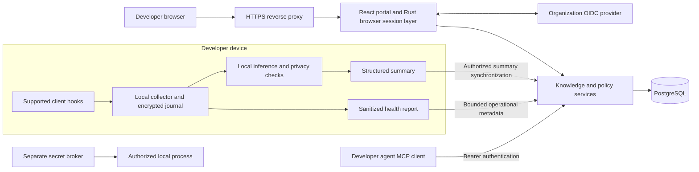

# Hosted developer portal: architecture and delivery proposal

Date: 2026-10-10
Status: user approved execution on 2026-10-10. Hosted identity is implemented and locally tested; the remaining increments below are proposed behavior until separately implemented and verified.

## 1. Intended outcome

One organization-hosted URL gives each developer a personal work context, authorized team context, and a place to configure Workspace Knowledge. Developers browse concise engineering summaries: intent, decisions, constraints, open questions, affected services, and evidence. Neither their own raw conversations nor teammates' conversation messages are exposed by the portal.

The portal must remain useful when capture is partial: developers can write structured context manually, review available summaries, and retrieve published knowledge. Missing capture is visible; absence of a summary does not imply absence of work.

Planning assumptions: one organization per deployment initially; multiple products and services; five developers for the first pilot; existing organization OIDC provider; local collector and local inference on each developer device. The schema retains organization isolation. A developer can have several devices. Administrators manage access and operational configuration, but do not receive application access to owner-only summaries merely because they administer the service.

## 2. Recommended approach and alternatives

**Extend the existing React console and Rust service.** Serve the portal and browser API through the same HTTPS origin. Reuse the knowledge, evidence, graph, membership and MCP services. Add browser sign-in, owner-only summaries, device status and configuration workflows in focused modules. PostgreSQL holds summaries and bounded operational metadata. This keeps one authorization model for the browser and agents.

A separate web backend is possible, but would duplicate identity, scope and policy logic and add another deployment for a small team. A centralized conversation collector would simplify device-side inference, but would move raw messages into the server's trust boundary and create a substantially larger privacy and compute obligation. Neither alternative is recommended for the initial portal.

## 3. System layout

The collector sends summaries and allowlisted diagnostics over outbound HTTPS. The hosted browser never connects directly to a developer's localhost collector, reads device files, or opens a raw-transcript endpoint. The server never needs to inspect all client histories. Inference remains local in the initial architecture.

The browser session layer is part of the Rust application, not a second business-logic backend. Browser session authentication and existing bearer authentication both resolve to the same trusted actor and authorization services. MCP retains per-request bearer authentication; browser cookies are not accepted as MCP credentials.

## 4. Visibility boundaries

| State | Stored where | Application readers | Retrieval behavior |
|---|---|---|---|
| Local raw capture / local candidate | Encrypted developer-device state | Local collector; owner through existing local tools | Never uploaded to the hosted portal or MCP |
| Owner-only sanitized summary | Server, after an explicit synchronization choice | Owner with current product/service membership | My context only; excluded from team search, graph, activity, exports and MCP |
| Submitted review summary | Existing server card workflow | Author and scoped reviewers | Review queue; excluded from ordinary team retrieval until published |
| Published team knowledge | Existing server cards | Members authorized for every included service | Team context, search, graph, overlaps and MCP |

The current `cards` behavior already allows scoped reviewers to read unpublished cards. Consequently, owner-only summaries need a separate table and access rule; they cannot be represented as ordinary unpublished cards without changing that privacy promise.

Owner-only synchronization is offered during setup and defaults to off until the developer chooses it. Once enabled for an approved workspace, eligible sanitized summaries synchronize without a new prompt on every turn. Sensitive, mixed-scope, incomplete or unsupported capture remains local. The portal reports a safe reason code and count, without reproducing the rejected content.

Submitting an owner-only summary for review deliberately creates a separate server card with an idempotency key. The action names the scoped reviewer audience. Publication creates team visibility only through existing policy and reviewer checks. Owner approval does not promote incomplete evidence to eligible capture. A developer may instead author an independent manual engineering note; it is labeled manual and cannot claim verified implementation without evidence.

Owner-only here means application authorization. Operators with database, backup or host access can potentially read server summaries. Storage encryption and restricted operational access reduce exposure but do not provide end-to-end encryption. If protection from the server operator becomes a requirement, that is a separate design with client-held keys and substantial search/recovery trade-offs.

## 5. Portal navigation and developer flows

### My context

The default page shows the selected product, the developer's recent sanitized summaries, their review submissions, and published contributions. Filters include service, date, client and visibility. Each entry shows intent, decisions, constraints, open questions, relative file references when safely available, lifecycle, evidence freshness and capture coverage.

Actions: edit an owner-only summary, submit it for review, delete it, add a manual note, or open an authorized published card. An edit uses an expected revision; a stale edit retains the user's text and requests a reload. The page contains no chat bubbles, prompt viewer, transcript download or hidden-reasoning display.

### Team context

Browse published work by developer, product, service, relative file reference and date. Search works before any personalized feed is introduced. Reuse the overlap service to show active file overlap and previously published related work. A teammate's profile consists of authorized published contributions and explicitly shared activity, never their owner-only summary history or collector errors.

Activity is optional and separate from durable knowledge. Show “last reported” and expiry rather than treating an old heartbeat as proof that someone is working now. No productivity scores, hours-worked inference or attendance rankings. When the user has no permissions, show an honest empty state without leaking other products, counts or developer names.

### Knowledge detail and relationships

Reuse the existing summary inspector, revisions, author-reported references, trusted evidence and reviewed relationship authoring. Keep lifecycle and evidence distinct: a proposed decision can be shared, but “implemented” or “tests verified” needs supporting evidence. Corrections invalidate stale evidence and return shared cards to review according to the current backend rules.

### Review queue

Visible only to reviewers in their service scopes. Explain exactly which submitted summaries they can see. Compare revisions, correct, publish, withdraw, or provide feedback. Owner-only summaries never appear in this queue until the owner explicitly submits them. Policy-auto remains unavailable until the existing privacy and capture gates pass; a setting cannot bypass them.

### Devices and setup

Select product and services; download the approved collector release; authenticate the local collector; approve local folders on the device; review generated hook configuration; run a synthetic verification; then view a capability checklist in the portal.

Report each client/surface/version separately as supported, experimental, partial, blocked or unknown. Distinguish “collector connected,” “hooks installed,” “event received,” “summary generated” and “shared context retrievable.” A green server health check cannot imply all capture clients work.

The present native results demonstrate only bounded Codex CLI no-tool capture on `0.162.0-alpha.2`; installed `0.162.0-alpha.17.2` was rejected by enrollment. Antigravity desktop `2.19.1` passed held capture/restart/disable checks but remains blocked for publication. These states must be represented honestly by the portal.

### Settings and administration

| Owner of setting | Examples | Enforcement location |
|---|---|---|
| Developer | Owner-only summary sync, activity sharing, display preferences, stricter review preference | Server preferences and collector effective policy |
| Local device | Exact folder approval, client-hook trust, credential store, local model and endpoint, capture pause | Local collector; hosted UI provides status and instructions |
| Product maintainer/reviewer | Service metadata, reviewer assignments, reviewed knowledge operations | Scoped server authorization |
| Organization administrator | Identity mappings, memberships, retention limits, allowed inference destinations, device revocation | Audited administrative service |
| Deployment operator | OIDC secrets, database URL, TLS, backup credentials, OpenBao configuration | Deployment secret management and operator tools |

Use an effective-settings view that explains whether a value comes from organization policy, product policy, or the developer. A developer can choose stricter privacy but cannot widen server permissions. Never display secrets or put credential values into generated commands.

Keep the existing administrative CLI for initial bootstrap. A later admin UI requires explicit administrative roles and narrowly authorized methods; do not expose the current privileged provisioning CLI as a generic HTTP command runner.

## 6. Identity and device connection

Replace token-paste login in production with OIDC authorization-code sign-in using PKCE, transaction-bound state and nonce, exact callback URLs, and a fixed configured issuer. The Rust session layer performs the token exchange. Store upstream tokens server-side, encrypted with an operator-managed key; send the browser only a random opaque session identifier in a Secure, HttpOnly, SameSite cookie. Rotate sessions on login and enforce an initial proposed 30-minute idle / 12-hour absolute lifetime. Logout revokes the server session and clears browser state.

Cookie-authenticated mutations need CSRF tokens and strict origin checks; cookies alone are not the defense. Authenticated content uses `Cache-Control: no-store`; no service-worker or local-storage cache holds context. Production removes the token-paste entry point. Current bearer verification remains for CLI and MCP requests.

Collector login uses the configured identity provider's device authorization flow if supported, or system-browser authorization-code/PKCE with an approved loopback redirect. Credentials are held in the OS credential store. The application does not build its own OAuth token issuer. Device registration binds the authenticated developer, product/services, installation identity and local approval hash. Device revocation must become an enforced authorization check, not just deleting a dashboard row; device IDs supplied in JSON are not proof of identity.

Every request checks current membership. Separate administrative permissions from `can_review`; reviewer status never grants membership management. The initial deployment has no automatic product access based solely on a successful sign-in or email domain.

References: [OAuth security best practice, RFC 9700](https://www.rfc-editor.org/rfc/rfc9700), [device authorization, RFC 8628](https://www.rfc-editor.org/rfc/rfc8628), [OWASP session management](https://cheatsheetseries.owasp.org/cheatsheets/Session_Management_Cheat_Sheet.html).

## 7. Device telemetry and configuration delivery

Add a strict report schema: registered device ID, product/services, collector version, client capability versions/statuses, capture paused flag, coarse queue counts, last successful synchronization, reason codes and reported-at time. Never send raw messages, native session IDs, absolute paths, arbitrary error strings, credentials or serialized local configuration. The owner can see detailed sanitized health; peers see only opted-in activity. Administrators see bounded operational health, not owner-only content.

A connected collector polls for its effective policy and user setting changes over HTTPS. Use versioned configuration and acknowledgments: requested, applied, rejected or device offline. Revoking a device blocks further uploads immediately at the server; local pause takes effect only when the device receives it, so the UI must show pending state honestly. No arbitrary remote shell execution or server-supplied hook command is permitted.

New folders, broader capture, a new inference destination or credential changes require local confirmation. A hosted checkbox cannot grant access to files the browser cannot verify. Reuse local approval, native enrollment and installation receipts for these changes.

## 8. Data model and API additions

Reuse `identities`, `products`, `memberships`, `workspace_bindings`, `cards`, `card_revisions`, `activity`, evidence, graph and tombstones. Add only:

- `browser_sessions`: hashed opaque session IDs, trusted identity mapping, encrypted upstream credentials when required, expiry and revocation.
- `developer_profiles`: organization-scoped display name; visible only through authorized product membership, with no public employee directory.
- `personal_summaries`: owner, organization/product/services, sanitized body, stable device-scoped source digest, revision, created/updated/expiry and optional submitted-card mapping. Strict owner-only RLS plus explicit service membership checks; no reviewer bypass.
- `registered_devices` and `device_reports`: owner, device credential binding, revocation, bounded health report and report expiry. Workspace approval hashes reuse existing bindings.
- `preferences` and `config_requests`: typed allowlisted values, target device/product, expected revision, effective policy version and acknowledgment. No secret values or command bodies.

Extend content-free audit metadata for login, sync, submission, publication, withdrawal, access/configuration changes and device revocation. Logs must omit summary bodies, search text, credentials and raw diagnostic payloads.

Proposed browser routes: `/auth/login`, `/auth/callback`, `/auth/logout`, `/v1/me`, `/v1/me/products`, `/v1/me/products/{product}/summaries`, `/v1/me/devices`, and `/v1/me/preferences`. Product routes add cursor-paginated published context and authorized developer/activity listing. Reuse existing card/review/evidence/relationship APIs rather than duplicating them. Device upload and policy routes use collector bearer identity and device binding; owner-only summaries receive no MCP tool.

All identifiers are validated; all routes enforce organization/product/service scope, including revisions, pagination counts, developer filters and exports. A multi-service record requires access to every included service. Cursor pagination is bound to filters; initial page size is 25 with a maximum of 100. Schema sizes and per-device rates are bounded. RLS tests use a non-owner, non-superuser application role.

## 9. Retention, offline behavior and withdrawal

Proposed defaults: existing local raw maximum remains 24 hours and local candidate draft expiry remains unchanged; owner-only server summaries expire after 30 days; sanitized device reports retain seven days; metadata-only audit events retain 90 days; published team knowledge persists until withdrawn or expired under an explicitly configured product policy. These are configuration proposals, not current behavior. A private server summary is created only from eligible output while its local source is valid; later user notes are separate records with manual provenance.

Devices can keep collecting within local consent and retention while the server is unavailable. They do not share without current authorization. Already synchronized hosted context remains readable when a developer's device is offline. Retry preserves submission idempotency and never extends raw retention or invents a new native session identity.

Deletion of owner-only summaries removes their hosted text and search visibility. Withdrawal of a shared card uses the existing tombstone/graph rules. Administrative membership/device revocation prevents new access and uploads. Published withdrawal cannot recall information already delivered to teammates or external model providers. Backup retention and restore replay must preserve deletions, including a new personal-summary deletion journal; promise neither immediate physical erasure nor retrieval from withdrawn records.

## 10. Server deployment and capacity

Deploy static web assets and one Rust application behind HTTPS, with PostgreSQL on a private network, the existing OIDC provider, and independent backup/monitoring. OpenBao remains separately authorized for environment values; the portal displays schemas and readiness only. Use the existing Docker/Compose foundation with separate migration and least-privilege application database roles. Configure health/readiness checks, resource limits, database pool limits and restore procedures.

For five developers, this architecture avoids hosting five continuous inference streams. A provisional pilot allocation is 2–4 vCPU, 8 GB RAM and 40 GB database storage plus separate backup space; this is a starting budget to validate, not a measured requirement or overload guarantee. Any central inference service requires a separate resource estimate and explicit privacy design.

Example summary storage model: five developers × 50 sanitized summaries per day × 10 KiB per summary is about 2.4 MiB/day, or 0.87 GiB/year of body data before revisions, indexes, WAL and backups. At a planning allowance of four times body storage this is about 3.5 GiB/year; actual usage depends on how many summaries are published and retained. A 30-day owner-only window bounds personal body data near 73 MiB under those assumptions. Measure database and backup growth during the pilot rather than accumulating per-turn transcripts.

Use paginated indexed queries and a 30–60-second visible-page status refresh initially. Avoid per-developer inference workers, all-history dashboards, default embeddings and event-stream infrastructure until measured demand requires them. Preserve the existing lexical search baseline. Load validation must include five active collectors, concurrent browser/MCP use, duplicate retries, offline catch-up and review operations; record p50/p95 latency, errors, database CPU/pool waits and daily growth.

## 11. Delivery sequence

This is a roadmap for several reviewable increments. Each increment needs its own implementation tasks and tests; the user authorized product-code execution after this proposal was presented.

| Increment | Deliverable | Main existing boundaries | Acceptance |
|---|---|---|---|
| 1. Hosted sign-in and identity | Same-origin browser sessions, `/me`, product selection, logout | `crates/server/src/auth.rs`, server router, `web/src/api.ts`, migrations | Real OIDC login; expired/revoked sessions; CSRF/origin rejection; existing bearer/MCP flow still works |
| 2. My context | Separate owner-only summary store, opt-in synchronization, personal list/detail and submission | `crates/agent/src/process.rs`, new agent sync module, knowledge module, migrations, web routes | Other developer and reviewer cannot read it by any route; no content enters MCP/team indexes; explicit submission becomes reviewable |
| 3. Team context | Published feed, developer/service/date filters and optional activity list | `crates/knowledge/src/activity.rs`, existing card retrieval, web | Two real identities and multiple service scopes; count/name isolation; stale activity; published/withdrawn revision correctness |
| 4. Device setup and controls | Device-auth connection, sanitized health, effective settings, pause/revoke acknowledgment | Local enrollment/state/network, workspace bindings, new device services | No credentials in commands; no remote local-path approval; offline/pending states; device revocation enforced on uploads |
| 5. Scoped administration and operations | Explicit admin roles, audited memberships/policy, retention/deletion worker, deployment configuration | Admin CLI, migrations, operations docs, Compose | Reviewer cannot administer; cross-product denial; deletion restore replay; backup restore; five-developer measured pilot |

Organize React screens by My context, Team context, Review, Devices and Settings, with shared summary/evidence components. Extract routes from the existing large `App.tsx` as these screens are introduced; avoid unrelated UI rewrites. Keep the existing quiet workbench design, readable prose, persistent scope labels, keyboard navigation and responsive layout. No dependency on hosted analytics, external fonts or proprietary dashboard services is needed.

## 12. Required proof before rollout

- Canary text placed in a synthetic raw prompt must not appear in hosted responses, logs, owner summaries rejected by screening, team search, MCP, embeddings or backups of server content. Test disclosure boundaries across every visibility state; sanitization is not a guarantee by itself.
- Use five distinct accounts, including a reviewer, administrator and restricted-service developer; exercise guessed IDs, author filters, histories, revoked membership, and multi-service records.
- Test capture gaps, client updates, model failure and held Antigravity turns as honest blocked states. A portal setting must never convert them into publishable evidence.
- Test cookie sessions, login callbacks, CSRF, XSS-safe summary rendering, allowed origins, logout and remote MCP bearer separation against a real test server and identity provider.
- Exercise duplicate synchronization, collector restart, device-offline edits, stale revision conflicts, pending pause, device revocation and deletion/restore with deterministic evidence.
- Verify responsive browser behavior and operational sizing under the pilot load. Record exact deployed versions and remaining limitations.

## 13. Source of the proposal

Repository inspection: `docs/architecture/console.md`, `backend.md`, `overlap-notices.md`, `private-capture-journal.md`, `remote-mcp.md`; `web/src/App.tsx`, `api.ts`, `types.ts`; `crates/server/src/auth.rs`, `lib.rs`, `main.rs`; `crates/knowledge/src/lib.rs`, `activity.rs`; server migrations; agent state/enrollment and native acceptance reports; `deploy/compose/compose.yaml`.

Some older overview/architecture documents still state that native adapters are unimplemented. The current native acceptance reports and code provide the narrower updated facts; the portal capability model must use tested version-specific evidence rather than those stale broad statements.
