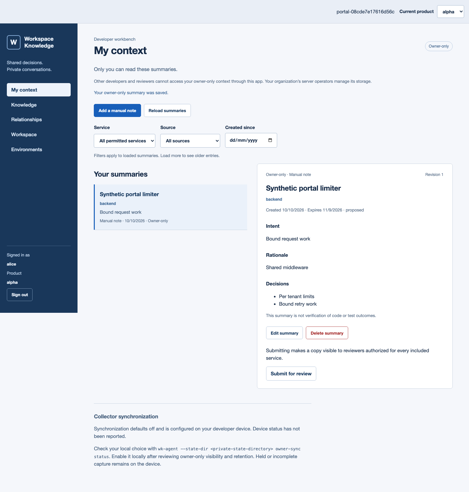
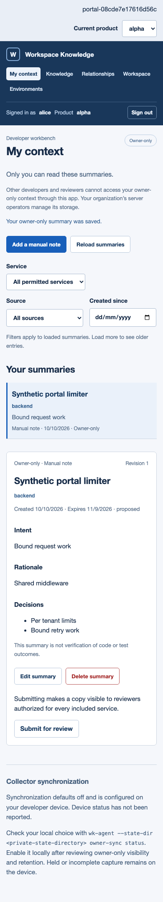

# Owner context acceptance — 2026-10-10

Implemented in the isolated `codex/cursor-native-capture` worktree; synthetic identities/content only. No real client settings, Keychain approvals or transcript access were needed for this increment.

- Real Rust server + disposable PostgreSQL + synthetic local OIDC provider passed fifteen identity/owner scenarios in both public and confidential client modes. A real Chromium browser signed in, created a structured multiline note, edited revision 2, made an explicit unpublished review copy, deleted the owner body and signed out. No browser network mocks in `web/scripts/owner-live.mjs`.
- Cookie owner mutations reject missing CSRF and an unapproved Origin. Wrong-owner guessed IDs return 404 and their list stays empty. Credential canary and unknown transcript fields receive generic errors without the rejected input.
- Repository/runtime-role tests cover owner/reviewer/cross-org isolation, every-service revocation, fixed expiry, delete/retry guards, chronological pagination, quota across hidden scopes, current-policy submission, atomic edit/submit races and private exclusion from search/review/graph/MCP before explicit sharing.
- Agent suite: 32 passed. Default-off status loads no credential, consent is pinned to local approval and remote/configuration scope, payload screening excludes incomplete content, transport retries safely, and restart markers do not extend source TTL. Existing source validation/held/revoke/expiry tests remain in place. This does not certify a live native-capture-to-owner upload on every client.
- Web build and all 16 browser regressions passed; desktop and 390px screenshots inspected. Relevant Rust tests and clippy/format checks passed; 48 server/knowledge tests passed, including all disposable-database tests (28 knowledge, 20 server).

The private body expires logically 30 days after creation. Deletion immediately clears it, retaining a content-free idempotency marker. Physical cleanup and private tombstone replay during restore remain an operations-increment gate before rollout. A submitted review copy is separate and is not deleted with its owner note. Database/backup operators remain trusted.

Synchronization defaults off and requires local opt-in; source completeness and version gates remain unchanged. Codex no-tool capture on 0.162.0-alpha.2 was previously bounded-live-tested; installed alpha.17.2 was rejected. Antigravity 2.19.1 remains held and blocked for publication. This portal acceptance does not expand those capabilities.

Production OIDC provider selection/certification, team context feed, device controls, scoped administration, measured five-developer capacity, privacy corpus and runtime RSA advisory remain release work. No server has been deployed or shared branch pushed.

Reproduce using a disposable database ending `/wk_test`: build `wk-server`, build `web`, set `WK_TEST_DATABASE_URL` privately, run `python3 scripts/portal-owner-smoke.py` (also `--public-client`). The provider binds literal loopback, generates only synthetic identities, and tears its processes down on exit. Repository DB tests run with `--include-ignored`; they use isolated random organization IDs and runtime roles.

## Independent review and final fixes

A fresh gpt-6-astra reviewer found three Important issues; each regression failed before its fix. Delivery now compares current config with the exact snapshot used for upload and binds the credential account to opt-in; an old destination receives zero requests after a different destination is approved. The editor can load and compare the latest saved body while retaining the draft, then save with that revision. An RLS-hidden unique-key collision becomes an opaque409 rather than503. Final suites:32 agent,48 knowledge/server,16 browser; clippy/format and both local-provider modes verified. No deferred minor findings.

## Decisions carried from execution

- Continue the already-approved owner increment without another approval prompt; a mistaken scope choice costs a reversible feature revision.
- Use chronological `(created_at,id)` pagination with UUID anchors; a mistake risks skipped/duplicate page boundaries and is covered by regression.
- Use a fixed-search-path, owner-checked SECURITY DEFINER capacity boolean for old service scopes, without content access or PUBLIC execution; a mistake risks broader database privilege.
- Review-copy key includes note/revision/current-policy and uses `owner-note` to pass shared privacy screening; cost is separate copies when policy changes.
- Pin opt-in to destination, device, service, model/inference, approval, policy and credential account; developers must re-enable after changes.
- Immediately acknowledge an empty encrypted success marker, preserving source TTL; content-free guards consume the existing bounded100,000-ID capacity.
- Rotate50 candidate records with a20-second budget; backlogs wait for later ticks.
- Incomplete/held capture remains local rather than appearing as uploaded owner notes; hosted diagnostics wait for Devices reporting.
- Filters are explicitly limited to loaded pages; older entries require pagination.

The reviewer declined physical cleanup/restore, external-provider certification, Devices, pilot capacity and broader native coverage because they belong to later increments. They remain required rollout gates, with no readiness claim here. Unrelated native changes were excluded; current screenshot artifacts were inspected locally. The cost of deferring these gates is that this increment alone cannot be deployed as a complete production portal.
