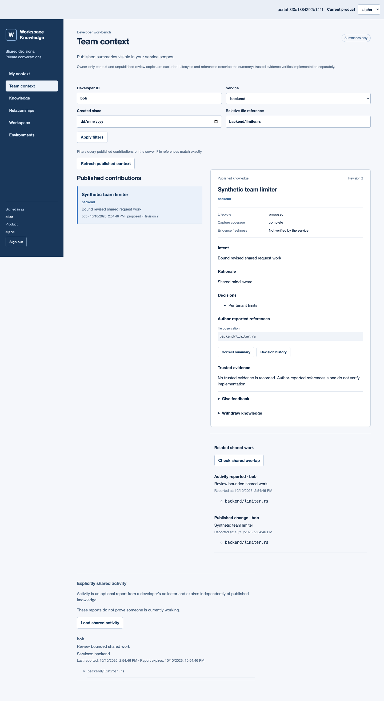
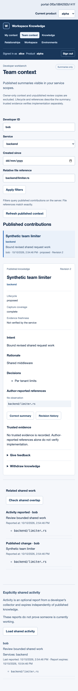

# Team context acceptance — 2026-10-10

The approved hosted portal now has a published Team context feed and an optional scoped activity list. Existing owner-only storage remains isolated; reviewer privileges do not add unpublished entries to this feed.

Real Rust/PostgreSQL/local-OIDC acceptance passed with alice and bob browser sessions, in both public and confidential client modes. It checked private/unpublished exclusion, every-service isolation, current corrected revision, withdrawal, heartbeat shape and explicit activity ending. Real Chromium used the live API without mocks to filter by author/service/file, open revision 2, inspect references/evidence, retrieve related work and load shared activity. Desktop and 390px screenshots were inspected.

- 54 knowledge/server tests passed, including disposable DB regressions, restricted-runtime RLS, cross-org/name isolation, same-time pagination, filter-bound anchors, correction/withdrawal and expired/ended/unsafe legacy activity exclusion.
- Web build and all 24 browser tests passed, including delayed old-product response cancellation, inert summary text, denied detail clearing, server filters, page deduplication and heartbeat wording. Clippy/format and whitespace checks passed.
- Feed pages contain up to 50 entries. It reads published, non-withdrawn shared cards, including clearly labeled historical lifecycle states. Author IDs come only from visible published contributions; no separate employee directory is queried.
- Shared activity is separately requested, capped at 50 unexpired records and displays last-report/expiry timestamps. It omits session IDs, private diagnostics and unsafe legacy fields. The UI removes expired reports on its 30-second local clock tick; refresh retrieves new reports. Neither heartbeat nor overlap implies live presence or hours worked.

Decisions: Continue the authorized roadmap inline (cost if wrong: reversible scope revision); reuse existing author IDs instead of adding a profile/directory (cost: less friendly labels until Settings); restrict pagination anchors to the current filters, as required by the spec (cost if wrong: skipped filtered entries, covered by regression); render structured overlap reports instead of inherited MCP prose claiming presence (cost: less narrative detail). The existing MCP prose contract is unchanged.

This increment does not certify a production identity provider, broaden native-client capture, deploy a server, measure five-developer load or complete Devices/Admin/retention/restore work. These remain rollout gates. Known runtime RSA advisory remains tracked. Reproduce against disposable `/wk_test` with `scripts/portal-team-smoke.py` and `--public-client`, after building `wk-server` and `web`; the harness tears down its local processes on exit.

Final independent review found three important issues. All were reproduced before changes and fixed in one pass: unsafe legacy activity is screened on overlap retrieval and new activity ingestion using the same rule as the activity feed; denied/unpublished detail removes the stale feed row and a newer current detail refreshes its excerpt; overlap references are deduplicated and capped at the server limit of 100. Regression tests each failed then passed. Final 54 Rust knowledge/server tests, 24 browser tests, build, clippy and real public-client two-identity workflow passed. No deferred minor findings.

Additional review rulings, in order: Production-provider compatibility, load, deployment and expanded native capture remain outside this Team increment (cost: rollout readiness stays unproven until those gates); independent code review excluded screenshot aesthetics while author inspected real responsive browser captures (cost: weaker independent visual assessment); inherited MCP presence prose remains unchanged because the portal renders dated structured reports (cost: MCP still overstates recent heartbeat presence).
