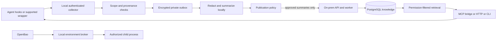

# Workspace Knowledge — Technical Specification

Date: 2026-09-30. Status: proposed build baseline derived from the stakeholder conversation. Working name: Workspace Knowledge; CLI name: `wk` (check naming availability before public release). This is a specification, not an implemented product or tested compatibility claim.

**Capture revision:** [Conversation-capture addendum](../../design-history/CONVERSATION-CAPTURE-ADDENDUM.md) adds Enterprise Desktop capture, an instrumented chat alternative, explicit processing-boundary changes, and typed graph provenance. It supersedes conflicting earlier capture assumptions.

## 1. Product contract

Build an open-source, self-hosted team knowledge system for developers using different AI agents in an explicitly approved product folder. That folder may contain frontend, backend, AI engine, shared code, and independent Git repositories. Automatically capture supported sessions, extract useful engineering knowledge, and make permitted summaries immediately discoverable by other agents. Preserve personal-folder boundaries and private raw conversations. Include team-approved environment sharing through a separate secrets broker.

The primary loop is: approve workspace once → work normally → capture supported events → generate policy-checked summaries → publish eligible knowledge → retrieve it before another agent plans related work. No per-prompt approval is required in the team-approved automatic mode. A developer can always choose a stricter review mode or pause.

Explicit rationale, intent, questions, and prompt refinements are in scope. Hidden model reasoning, unspoken human thoughts, screenshots of all activity, global chat-history scraping, and machine-wide traffic interception are out of scope.

## 2. Decisions and boundaries

- Native CLI and background daemon on Windows, macOS, and Linux; browser-based administration. “Any OS” means these tested desktop/server families initially, not mobile or every Unix distribution.
- Rust workspace for CLI, daemon, API, worker, MCP bridge, policy engine, and connectors. Use Tokio, Serde, Axum, SQLx and maintained official MCP Rust SDK where suitable. Pin exact dependencies and a supported Rust toolchain during bootstrap; commit lockfiles.
- SQLite local metadata/outbox, with authenticated encryption of raw payloads using a maintained cryptography library and per-device keys in the OS credential store. PostgreSQL for shared records, authorization, jobs, and full-text search. Add pgvector and on-premises embeddings after the lexical retrieval baseline.
- React + TypeScript + Vite for a small web console served by the API. CLI and MCP remain usable without this console.
- Prefer connector hooks over network interception. Optional future gateway is limited to explicitly configured clients; it cannot transparently observe every agent or encrypted request.
- Local summarization by default through a configured local inference endpoint. Optional on-premises shared inference requires an explicit workspace policy allowing redacted conversation segments to leave the device; the service does not persist these segments.
- MCP stdio bridge is the broadest local-client integration. An authenticated Streamable HTTP endpoint supports compatible clients. CLI JSON commands are the fallback.
- OpenBao adapter for environment secrets; no custom vault or cryptographic protocol. OpenBao is optional for knowledge-only operation.
- Apache-2.0 proposed license for this project; preserve dependency licenses and notices. No mandatory proprietary cloud, paid API, or hosted identity dependency.

## 3. Global constraints

1. Support native clients on Windows, macOS, and Linux; certify exact OS/client versions in a release matrix.
2. No collection before local developer approval and server-side product membership.
3. No raw conversation payloads in shared knowledge storage, embeddings, application logs, or telemetry.
4. No personal-folder traversal; no implicit parent, sibling, symlink, junction, worktree, or submodule approval.
5. Never expose secret values through knowledge search or MCP responses.
6. Automatic publication requires both team policy and local developer opt-in; uncertain content remains private.
7. All shared reads and writes enforce authenticated organization/product/service permissions.
8. Capture failures must not block development; publication and secret access fail closed.
9. No hidden reasoning collection; unsupported client capabilities are reported explicitly.
10. Existing client configurations and agent instructions must be preserved during setup and uninstall.
11. All configuration examples and CLI commands in this package are proposed interfaces, not currently installed commands.

## 4. Workspace enrollment and consent

Proposed onboarding:

```sh
wk login --server https://knowledge.internal
wk workspace init /absolute/product --product product-id
wk workspace approve /absolute/product --publish policy-auto
wk agent connect cursor --workspace /absolute/product
wk agent connect claude-code --workspace /absolute/product
wk agent connect codex --workspace /absolute/product
wk agent connect antigravity --workspace /absolute/product
wk doctor --workspace /absolute/product --json
```

Windows paths are accepted natively. First enrollment is explicit and shows directories, publication mode, inference destination, retention, and environment permissions. A checked-in manifest is a proposal, never proof of consent. Store local approval and its policy hash outside the repository. A Git change cannot enlarge access; scope expansion requires fresh consent. `wk workspace pause`, `resume`, `revoke`, and `forget` have distinct documented behaviors; resume is explicit.

Example `.wk/workspace.yaml` (no tokens or machine-specific absolute paths):

```yaml
schema_version: 1
product_id: customer-portal
services:
  - { id: frontend, path: frontend }
  - { id: backend, path: backend }
  - { id: ai-engine, path: ai-engine }
  - { id: shared, path: shared }
exclude: [personal/**, '**/.env', '**/.env.*', '**/*.pem', '**/.git/**', '**/node_modules/**']
publication: policy-auto
inference: local
raw_retention_hours: 24
environment_profiles: [development]
```

Unknown folders under the root are unclassified and not automatically ingested. `docs/` or the root itself can be added as explicit services. Discovery may suggest directories within the approved root without opening their files; it never scans the home directory. Repository remotes, branch names, filenames, and comments can themselves be sensitive; remove embedded credentials and apply metadata exclusions.

Resolve real paths and compare path components, not string prefixes. Account for Windows drive letters, case behavior, UNC paths, reparse points, Unicode, deleted files, and symlink races. For nonexistent output files, validate the existing parent and revalidate on use. Network shares are outside initial certification; explicitly supported mounts can be added later. A new Git worktree outside the approved root requires enrollment. WSL and containers are distinct execution environments with explicit mount mapping.

Capture consent does not sandbox the AI agent. Configure client sandbox permissions separately when out-of-folder reads must be prevented. Shell commands and pasted prompts may contain external context without observable file events; do not claim a perfect content-origin detector.

## 5. Architecture



Run one daemon per OS user. Prefer Unix domain sockets on Unix and user-restricted named pipes on Windows. MCP starts `wk mcp --workspace <approved-root>` and talks to that daemon. A loopback HTTP fallback requires per-user authentication, explicit Host/Origin validation, and no permissive CORS. No unauthenticated LAN listeners.

Server processes: `wk-server` exposes API, remote MCP and web assets; `wk-worker` processes publication/index jobs. Start with PostgreSQL-backed jobs using leases and retries, not Kafka/Redis/microservices. Reverse proxy supplies TLS. Production auth uses an existing OIDC provider; a local development identity mode binds only to loopback and cannot serve production.

## 6. Client compatibility strategy

Documentation reviewed on 2026-09-30; all rows require live version-specific certification. MCP availability is not proof of capture coverage, and successful config installation is not proof of an operational connection.

| Client surface | Retrieval | Capture proposal | Initial release claim |
|---|---|---|---|
| Cursor IDE | Local MCP bridge; compatible remote MCP | Documented prompt, response, tool and session hooks | Automatic capture after fixture replay and live tests |
| Cursor CLI | MCP/CLI bridge | Test its hook coverage independently | Separate capability record from IDE |
| Claude Code CLI | MCP | Prompt, tool, stop and session hooks | Automatic for tested versions |
| Claude Code inside desktop | MCP where supported | Validate Claude Code hook behavior in that surface | Never inherit certification solely from CLI |
| Claude Desktop general chat | Local MCP extension/bridge | Optional Enterprise Compliance API for explicitly bound work chats; cooperative fallback otherwise | Real message retrieval subject to entitlement and live certification; see capture addendum |
| Codex CLI / desktop | MCP bridge | Documented prompt, tool, stop hooks; separate desktop test | Capture observed fields; missing responses remain marked partial |
| Codex managed wrapper | MCP plus App Server integration | Events from sessions launched by this wrapper | Does not imply attachment to arbitrary existing desktop sessions |
| Antigravity IDE / 2.0 / CLI | MCP | Documented invocation/tool/stop hooks; transcript extraction only with explicit scoped consent and tested parser | Surface-specific coverage, initially partial until proven |
| Gemini CLI | MCP | Documented lifecycle/model hooks | Optional first-release connector after primary clients |
| Other agents | MCP or CLI JSON | Cooperative summary submission or adapter SDK | Retrieval without automatic capture guarantee |

Codex documentation identifies transcript format as unstable. Prefer direct hook fields; version-gate any parser. Antigravity invocation hooks may supply transcript references rather than full prompt/response fields. Reading agent-owned transcript files outside the product folder needs a separate narrow consent grant: only the identified current session, no directory crawl, verified session/workspace metadata, and no reused mixed-workspace history. If safe extraction is not possible, use cooperative summaries and report partial capture. Never enable such an exception merely because a payload contains a filesystem path.

A capability record contains client version, OS, surface, adapter version, prompt/response/tool/session coverage, attribution quality, tested date and proof. Status is one of `untested`, `verified`, `partial`, `unsupported`, `degraded`. Unknown versions start partial; they cannot silently upgrade to complete.

## 7. Capture, correlation, and knowledge lifecycle

Event identity: organization + device + connector + session + agent instance + turn + native event identifier. If no native event ID exists, derive a local idempotency key from a persisted connector sequence/cursor. Clock time is presentation data, not the primary join key. Preserve parent event, parent agent, request/response and retry relationships. Do not merge parallel agents just because they share a session ID.

Private event shape (schema v1):

```json
{
  "schema_version": 1,
  "event_id": "uuid",
  "device_id": "uuid",
  "product_id": "customer-portal",
  "workspace_binding_id": "uuid",
  "connector": "cursor",
  "session_id": "native-session",
  "agent_instance_id": "main",
  "turn_id": "native-turn",
  "parent_event_id": null,
  "kind": "assistant.response",
  "sequence": 12,
  "completion": "complete",
  "scope": "approved",
  "service_ids": ["backend", "ai-engine"],
  "relative_paths": ["backend/search.ts"],
  "private_payload": {"text": "local-only conversation content"}
}
```

Allowed kinds: `session.start`, `user.prompt`, `assistant.response`, `tool.result`, `file.changed`, `turn.end`, `session.end`, `capture.gap`. Raw payloads are size-bounded to 1 MiB per event initially; larger events are marked truncated and ineligible for automatic conversation publication. File tools capture safe path metadata by default; do not ingest arbitrary command output or file contents wholesale. Ephemeral raw parsing is unavoidable for some hooks; excluded payloads are discarded before persistence.

Process asynchronously at turn completion; coalesce related updates for 15 seconds, with a 60-second maximum wait for completed turns. Session end flushes immediately. Crashes leave recoverable pending events; missing turn boundaries create partial drafts, never fabricated completions. Stable idempotency keys prevent duplicate cards on retry. Empty/purely conversational turns may produce no card.

Generate structured cards: intent summary, explicit rationale, decisions, alternatives, constraints, service links, evidence, unresolved questions, lifecycle status, capture completeness, author, and revision. No verbatim prompt reconstruction. Each claim carries evidence kind: `conversation_report`, `file_observation`, `commit`, `reviewed_pr`, `test_result`, or `owner_attestation`.

Lifecycle: `proposed` → `in_progress` → `implemented` → `verified`; `superseded` and `deprecated` are explicit transitions. Merging does not imply tests passed. Test evidence includes command, result, code revision, execution time, and relevant environment. Stale evidence cannot verify a new revision. Two conflicting cards coexist with a conflict link until resolved; semantic similarity alone never overwrites another developer's decision.

Publication state is separate: `private_draft` → `policy_checked` → `published`; otherwise `needs_review`, `rejected`, or `withdrawn`. Published cards indicate whether approval was automatic or human and display the governing policy version.

## 8. Automatic publication and privacy

Effective permission is the intersection of organization policy, product membership, service permissions, local consent, and session restrictions. A developer can narrow team policy. Capture does not imply publication or secret access.

`policy-auto` publishes only complete, attributed, in-scope, sanitized summaries of eligible card types. Cross-service cards are visible only to readers authorized for every included service; optionally generate independently sanitized service cards. Mixed/unclassified sessions and sensitive findings are held locally. Prior content contamination persists across later turns until a demonstrably clean session boundary; do not assume a later in-folder tool call removes personal context.

Use deterministic secret detection, known-secret fingerprints where available, restricted-pattern rules, output validation, and a privacy classifier. Model confidence alone is insufficient. Detection is probabilistic for free text; disclose residual risk and offer `review-required` for teams requiring manual confirmation. Automatic summaries are allowed by the user's intended operating mode, not an unconditional privacy guarantee.

Raw retention defaults to 24 hours, configurable down to zero (in-memory processing). Queue cap defaults to 100 MiB encrypted payloads per device; overflow produces a content-free gap notification. No raw cloud fallback. Inference outage queues within these bounds; content expires rather than silently extending retention. OS key-store absence leaves persistent capture disabled; never write plaintext keys as fallback.

On-prem deployment describes this platform. Summaries returned to a cloud AI client may be processed by that client's model provider. Product policy includes `allowed_consumers` and whether external-model egress is approved. Unknown consumers are denied until registered. Strict internal-only teams use approved local-model clients and network controls. The platform cannot stop an authorized human from copying data or a privileged compromised endpoint from reading memory.

## 9. Data model and API contracts

Server tables: organizations, users, memberships, products, services, workspace_bindings, policies, cards, card_revisions, card_services, evidence, card_links, publication_jobs, audit_events, environment_profiles, environment_bindings, tombstones. Raw events exist only in the local store. Server environment bindings hold vault references, never secret values.

Every protected row is scoped by organization and product, with service relations where relevant. SQL constraints enforce tenant-consistent foreign keys. Authorization is applied within queries before snippets, counts or vector candidates are returned. Use PostgreSQL row security as defense in depth; migration-owner connections are not application connections. Search caches are keyed by identity/permission version and invalidated on changes. v0.1 has no persistent offline cache of teammates' content.

Proposed REST surface:

- `POST /v1/workspace-bindings`: enroll a device-local workspace to an existing authorized product.
- `GET /v1/policy`: return effective policy and revision.
- `POST /v1/cards`: accept sanitized card submission with idempotency key and policy revision.
- `GET /v1/cards/{id}`: return authorized latest or requested revision.
- `PATCH /v1/cards/{id}`: optimistic update using expected revision; stale writes return 409.
- `POST /v1/search`: query, service/status filters, bounded result count.
- `POST /v1/context`: assemble bounded relevant summaries and citations.
- `POST /v1/cards/{id}/withdraw`: revoke visibility and queue deletion/index invalidation.
- `GET /v1/environments/{profile}/schema`: authorized variable names and safe metadata only.

Auth failures return 401; inaccessible IDs and nonexistent IDs have indistinguishable 404 behavior. Validation returns 422; rate limits 429; unavailable inference/search dependency 503 with safe retry guidance. Server derives author and organization from identity; client-supplied values cannot impersonate another user. Re-evaluate policy on upload; stale policy cannot publish while disconnected.

MCP tools use the same service layer and identity:

| Tool | Input | Output |
|---|---|---|
| `knowledge.context` | query, optional service IDs, budget_tokens ≤ 2000 | Relevant summaries, revision/status/evidence, freshness and omissions |
| `knowledge.search` | query, filters, limit ≤ 20 | Authorized card previews |
| `knowledge.get` | card_id, optional revision | One authorized card |
| `knowledge.record` | structured summary + evidence references | Draft/submission ID and publication state; never directly marks work verified |
| `knowledge.feedback` | card_id, revision, issue, suggestion | Correction request ID |
| `workspace.status` | none | Bound workspace, services, policy and connector health |
| `environment.describe` | service_id, profile | Variable schema and readiness; no values |

Context calls are bound to the enrolled product rather than allowing arbitrary filesystem paths. Sanitize outgoing retrieval queries too: an agent can accidentally include secrets in its search text. MCP roots are hints, not authorization. Treat retrieved content as untrusted reference data; strip active markup in the UI and never execute embedded instructions.

Local stdio authenticates through the user's daemon session. Remote MCP must follow the negotiated MCP authorization specification, validate token issuer/audience/expiry/scopes, and never pass client tokens to unrelated upstream services. Secrets credentials are separate from knowledge credentials.

## 10. Shared environment management

Knowledge contains variable definitions, safe defaults, setup instructions, environment versions, and vault references. Secret values live in OpenBao. Team-approved nonsecret config can be shared directly; secret access is independently authorized per product/service/profile.

Proposed CLI:

```sh
wk env describe --service backend --profile development
wk env import --service backend --profile development --file backend/.env
wk env run --service backend --profile development -- npm run dev
```

Import is an explicit developer operation: preview key names and classification, then upload approved values directly to the vault over TLS. Never auto-ingest `.env` through ordinary collection. Do not put values in command arguments, terminal output or knowledge events. No hidden `get_secret` MCP tool.

`env run` fetches short-lived credentials where supported, injects them directly into the child process environment, and passes arguments without shell interpolation. The user can request a restricted local `.env` export when tooling requires it; refuse tracked destinations, enforce Git-ignore and user-only file permissions, and record only key names and version. Account for Windows ACLs. Capture excludes broker I/O and suppresses known secret echoes where possible. Arbitrary child processes can print or exfiltrate credentials; only authorize trusted commands and do not claim universal secrecy from the agent's terminal tools. Production access is off by default and requires separately granted policy. Audit leases, revoke on access removal, and test rotation.

## 11. Performance, reliability, and operations

Initial targets, to be benchmarked rather than advertised as achieved:

- On an idle reference developer machine, p95 collector enqueue ≤ 100 ms; hook exits within 250 ms or records a gap. No model calls on a hook's synchronous path.
- On a 4-vCPU/8-GiB server, 100,000 cards and 20 concurrent readers, p95 lexical search ≤ 500 ms excluding network transit; context ≤ 1 s excluding external model generation.
- Eligible cards searchable ≤ 60 seconds after completed turn under the declared inference hardware/load. Publish actual model, hardware, throughput and failure rates in benchmark results.
- Context defaults to ≤ 2,000 tokens, top 8 cards; long evidence fetched on demand. Pagination and request limits are enforced server-side.
- Exponential retry with jitter and idempotent jobs; bounded queues and explicit degraded status. Development continues during server/inference outage.

Use content-free metrics: queue age, dropped/truncated counts, inference latency, publication outcomes, permission denials and connector health. Logs omit prompts, summaries, secrets and raw request bodies. No outbound telemetry by default.

Back up shared PostgreSQL and vault using their respective procedures, encrypt backups, and test restore. Suggested initial RPO 24 hours/RTO 4 hours for small teams, to be measured. Withdrawn records disappear from live indexes immediately; backup expiry defaults to 30 days. Reapply deletion tombstones after restore before serving traffic. Local encrypted raw stores are excluded from platform backups.

## 12. Delivery sequence and release requirements

Milestone A: safe vertical slice—workspace enrollment, synthetic connector, local encrypted queue, deterministic fake summarizer, authenticated shared cards, lexical search, stdio MCP, and two-user permission tests.

Milestone B: useful automation—real local inference, policy-auto publication, Cursor and Claude Code adapters, setup/doctor, evidence lifecycle, and live two-developer feature-reuse demonstration.

Milestone C: requested client coverage—Codex CLI/desktop, Antigravity surfaces, Claude Desktop retrieval/cooperative submission, Gemini CLI, native OS packaging, and service-manager behavior.

Milestone D: environments and public release—OpenBao broker, minimal console, optional embeddings, deployment/restore, documentation, security hardening, license and contributor workflow.

Do not call a milestone complete using mocked client compatibility. Each named client needs an actual MCP search smoke test; capture needs a synthetic unique prompt/response pair in a test workspace, plus an outside-folder negative test. Proprietary clients may require manual release certification; unit fixtures do not replace it.

Public release includes LICENSE, NOTICE, README, CONTRIBUTING, CODE_OF_CONDUCT, SECURITY, threat model, protocol schemas, migrations, adapter authoring guide, synthetic fixtures, migration/rollback guide, signed artifacts/checksums, SBOM, dependency/license scan, and offline installation bundle. DCO sign-off is the proposed contribution policy. No real team transcripts in fixtures or issue reports.

## 13. Official integration references

Capabilities below support the proposed adapter design; they do not certify this unbuilt application. Recheck before implementing each adapter.

- [Cursor hooks](https://prod.cursor.com/docs/hooks): prompt/response/tool/session surfaces.
- [Cursor MCP](https://prod.cursor.com/help/customization/mcp): external tool access.
- [Claude Code hooks](https://code.claude.com/docs/en/hooks): lifecycle event schemas.
- [Claude Desktop local MCP](https://support.claude.com/en/articles/10949351-getting-started-with-local-mcp-servers-on-claude-desktop): local integration setup.
- [Codex MCP](https://learn.chatgpt.com/docs/extend/mcp?surface=cli), [Codex hooks](https://learn.chatgpt.com/docs/hooks), [Codex App Server](https://learn.chatgpt.com/docs/app-server): distinct retrieval, hook and owned-session integration mechanisms.
- [Antigravity MCP](https://antigravity.google/docs/mcp), [Antigravity hooks](https://www.antigravity.google/docs/hooks): client surface configuration and event payloads.
- [Gemini CLI hooks](https://geminicli.com/docs/hooks/reference/): connector reference.
- [MCP authorization](https://modelcontextprotocol.io/specification/2026-07-28/basic/authorization): remote protocol security contract; negotiate supported version.
- [OpenBao dynamic database secrets](https://openbao.org/docs/secrets/databases/): short-lived database credential capability.
